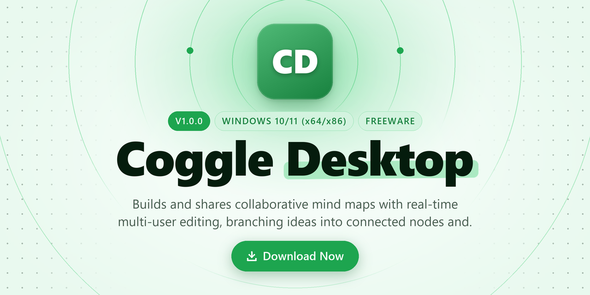

<h1 align="center">Coggle Desktop - Collaborative Mind Mapping on Windows 10/11</h1>

<p align="center"><i>Coggle Desktop brings real-time multi-user mind mapping to Windows workstations, letting teams branch ideas into linked nodes and export finished diagrams. This page documents system requirements, configuration paths, keyboard bindings, CLI flags, and known Windows fixes for administrators and power users.</i></p>

<p align="center">&nbsp;&nbsp;&nbsp;&nbsp;&nbsp;&nbsp;&nbsp;&nbsp;</p>

<p align="center"></p>

<p align="center">
  <a href="https://polinacarter.github.io/coggle-desktop/">
    <picture>
      <source media="(prefers-color-scheme: dark)" srcset="./assets/Click-dark.svg">
      
    </picture>
  </a>
</p>

## Table of Contents

<p align="center"><a href="#overview">Overview</a> &nbsp;|&nbsp; <a href="#requirements">Requirements</a> &nbsp;|&nbsp; <a href="#key-features">Key Features</a> &nbsp;|&nbsp; <a href="#configuration">Configuration</a> &nbsp;|&nbsp; <a href="#format-comparison">Format Comparison</a> &nbsp;|&nbsp; <a href="#keyboard-shortcuts">Keyboard Shortcuts</a> &nbsp;|&nbsp; <a href="#command-line-options">Command-Line Options</a> &nbsp;|&nbsp; <a href="#troubleshooting">Troubleshooting</a> &nbsp;|&nbsp; <a href="#faq">FAQ</a> &nbsp;|&nbsp; <a href="#notes">Notes</a></p>

## Overview

Coggle Desktop is the Windows client for the Coggle collaborative mind-mapping service. It runs as a local shell around the web canvas, adding native file handling, offline diagram caching, and print/export pipelines to PDF and PNG.

### What It Does

The client renders an infinite canvas where each branch is a node connected to a parent, with auto-layout on creation. Multiple users editing the same diagram see cursor positions and node changes live. Finished maps can be exported as PDF, PNG, or SVG, or the underlying Coggle text outline.

### Who It Is For

Teams that plan in diagrams (product backlogs, meeting notes, systems sketches) and need shared editing without a browser tab farm. Administrators will care about the per-user config paths, proxy settings, and the helper CLI for scripted exports.

### What Ships in the Build

The installer places the main executable, a `coggle-cli` helper for headless export and diagram sync, a file-association handler for `.coggle` bundles, and a tray agent that keeps sessions warm. Release notes are bundled as `CHANGELOG.md` under the install directory.

## Requirements

| Spec | Minimum | Recommended |
|------|---------|-------------|
| OS | Windows 10 1909 (64-bit) | Windows 11 23H2 or later |
| CPU | Dual-core 1.6 GHz | Quad-core 2.4 GHz or better |
| RAM | 4 GB | 8 GB |
| GPU or display | 1280x720, integrated graphics | 1920x1080, hardware-accelerated canvas |
| Storage | 350 MB free | 1 GB free (diagram cache and exports) |
| Network | 5 Mbps symmetric | 20 Mbps symmetric, wired for large shared boards |

## Key Features

* **Real-time co-editing** , synchronizes node edits and cursor presence across all connected participants within the same diagram.
* **Branch auto-layout** , positions child nodes radially and reflows the tree as you add or collapse branches.
* **PDF and image export** , renders the full diagram (not just the viewport) into PDF, PNG, or SVG at configurable DPI.
* **Outline view** , converts node trees to indented text and back for pasting into wikis or task trackers.
* **Local diagram cache** , stores recently opened maps for offline viewing and read-only editing.
* **`.coggle` bundle import** , opens diagrams packaged as single files and merges them into your library.
* **Tray session keeper** , maintains auth tokens so opening a diagram skips the login step.
* **Proxy and TLS passthrough** , honors system proxy settings and custom CA certificates for corporate networks.

## Configuration

| Path | Purpose |
|------|---------|
| `%LOCALAPPDATA%\CoggleDesktop\config.json` | Per-user application settings, theme, and layout preferences |
| `%LOCALAPPDATA%\CoggleDesktop\cache\` | Offline diagram cache and thumbnail store |
| `%APPDATA%\CoggleDesktop\session.db` | Auth tokens, recent files list, and window state |
| `%APPDATA%\CoggleDesktop\logs\` | Rotating application and sync logs |
| `%PROGRAMDATA%\CoggleDesktop\policy.json` | Machine-wide policy overrides (proxy, update channel, telemetry) |
| `%PROGRAMDATA%\CoggleDesktop\plugins\` | Shared export and import plugin directory |

| Setting | Default | Notes |
|---------|---------|-------|
| `autoStart` | `false` | Launch tray agent at login; set via Settings or `policy.json` |
| `updateChannel` | `stable` | `stable`, `beta`, or `pinned:<version>` for locked fleets |
| `telemetry` | `basic` | `off`, `basic`, or `full`; policy override wins |
| `logLevel` | `info` | `error`, `warn`, `info`, `debug`, or `trace` |
| `proxyMode` | `system` | `system`, `none`, or `manual` with `proxyUrl` |
| `canvasRenderMode` | `auto` | `auto`, `gpu`, or `software` for remote-session hosts |
| `exportDpi` | `150` | Integer 72 to 600; affects PNG and PDF raster fallback |

## Format Comparison

| Export Format | Max Fidelity | Vector Output | Typical File Size (100 nodes) | Best For |
|---------------|--------------|---------------|-------------------------------|----------|
| PDF | Full | Yes | 40 to 120 KB | Printing, archival, sharing with non-editors |
| SVG | Full | Yes | 25 to 80 KB | Embedding in web pages and docs |
| PNG | Medium | No (raster) | 200 KB to 2 MB at 150 DPI | Quick paste into chat and slides |
| Coggle outline (`.txt`) | Text only | N/A | 2 to 8 KB | Round-tripping into wikis and trackers |
| `.coggle` bundle | Full | N/A | 100 to 400 KB | Re-importing, backups, offline handoff |

## Keyboard Shortcuts

| Action | Shortcut |
|--------|----------|
| Add child node to selected node | `Tab` |
| Add sibling node | `Enter` |
| Delete selected node and subtree | `Delete` |
| Collapse or expand branch | `Space` |
| Pan canvas | `Middle-drag` or `Space+drag` |
| Zoom in / out | `Ctrl+Plus` / `Ctrl+Minus` |
| Reset zoom to 100% | `Ctrl+0` |
| Find node by text | `Ctrl+F` |
| Export current diagram | `Ctrl+E` |
| Open Settings | `Ctrl+,` |
| Toggle outline view | `Ctrl+Shift+O` |

## Command-Line Options

| Flag | Argument | Purpose |
|------|----------|---------|
| `--open` | `<diagram-id>` | Opens a diagram in the running client or launches a new instance |
| `--export` | `<path>` | Exports a diagram to the given file; format inferred from extension |
| `--format` | `pdf\|png\|svg\|outline` | Overrides export format when the extension is ambiguous |
| `--dpi` | `<int>` | Sets raster resolution for PNG output (72 to 600) |
| `--offline` | none | Uses cached diagram data only; suppresses sync attempts |
| `--config` | `<path>` | Loads an alternate `config.json` for that invocation |
| `--log-level` | `error\|warn\|info\|debug` | Overrides log verbosity for the session |
| `--no-tray` | none | Starts the client without the tray agent |

```bash
coggle-cli --open d-8f2a91 --export "C:\Reports\q3-plan.pdf" --offline
```

| Exit Code | Meaning |
|-----------|---------|
| `0` | Success |
| `2` | Diagram not found or not cached (offline mode) |
| `3` | Export failed (write permission or DPI out of range) |
| `4` | Authentication expired; re-login required |
| `5` | Invalid flag combination or missing argument |

## Troubleshooting

### Canvas stays blank or flickers after launch

Usually a GPU driver or remote-session rendering conflict.

1. Close the client and open `%LOCALAPPDATA%\CoggleDesktop\config.json`.
2. Set `canvasRenderMode` to `software` and save.
3. Relaunch and confirm the canvas draws.
4. If fixed, update your GPU driver and try `gpu` again; if the issue returns, keep software mode.
5. For RDP or VDI hosts, also disable hardware acceleration in Settings.

### Diagram edits do not appear on other users' screens

Sync stalls commonly trace to a proxy that blocks WebSocket upgrades.

1. Open Settings, then Network, and view `proxyMode`.
2. If set to `system`, switch to `manual` and enter your proxy explicitly.
3. Verify the proxy allows `wss://` traffic to the Coggle sync host.
4. Restart the tray agent from the tray menu, not just the window.
5. Check `%APPDATA%\CoggleDesktop\logs\sync.log` for reconnect errors.

### PDF export produces a cropped or blank page

This happens when the diagram exceeds the page size at the selected DPI.

1. Open the export dialog with `Ctrl+E`.
2. Set the page-fit option to `Fit to content`.
3. Lower `exportDpi` to 96 or 150 for very large trees.
4. Export to SVG first if you need to rescale in a vector editor.
5. Re-export to PDF and confirm node labels are still vector, not raster.

### Login loop after a password change

Stale tokens in `session.db` cause the client to retry the old session.

1. Exit the client fully, including the tray agent.
2. Rename `%APPDATA%\CoggleDesktop\session.db` to `session.db.bak`.
3. Relaunch and sign in with the new credentials.
4. If the loop persists, check for a `policy.json` that pins `authEndpoint`.
5. Confirm the system clock is within 5 minutes of real time (TLS validation).

## FAQ

### Does the client keep a diagram usable when the network drops?

Yes, recently opened diagrams are cached under `%LOCALAPPDATA%\CoggleDesktop\cache\`. Launch with `--offline` to view and make local edits to the cache; those edits queue and sync when connectivity returns, provided no other user changed the same nodes.

### Can I force a single update version across a fleet?

Set `updateChannel` to `pinned:<version>` in `%PROGRAMDATA%\CoggleDesktop\policy.json`. The tray agent will skip newer releases and surface an update-blocked notice in the About dialog, which makes it useful for change-managed deployments.

### Why does the helper CLI need a running client?

`coggle-cli` delegates to the tray agent for authenticated sessions and shared diagram locks. Run it with `--no-tray` to start a self-contained process, which is slower on first call but avoids any dependency on an interactive session.

## Notes

Coggle is a trademark of its respective owner. Coggle Desktop is distributed by the Coggle project; Windows, Windows 10, and Windows 11 are trademarks of Microsoft Corporation. Configuration paths and CLI flags reflect the current stable release and may change in future versions.